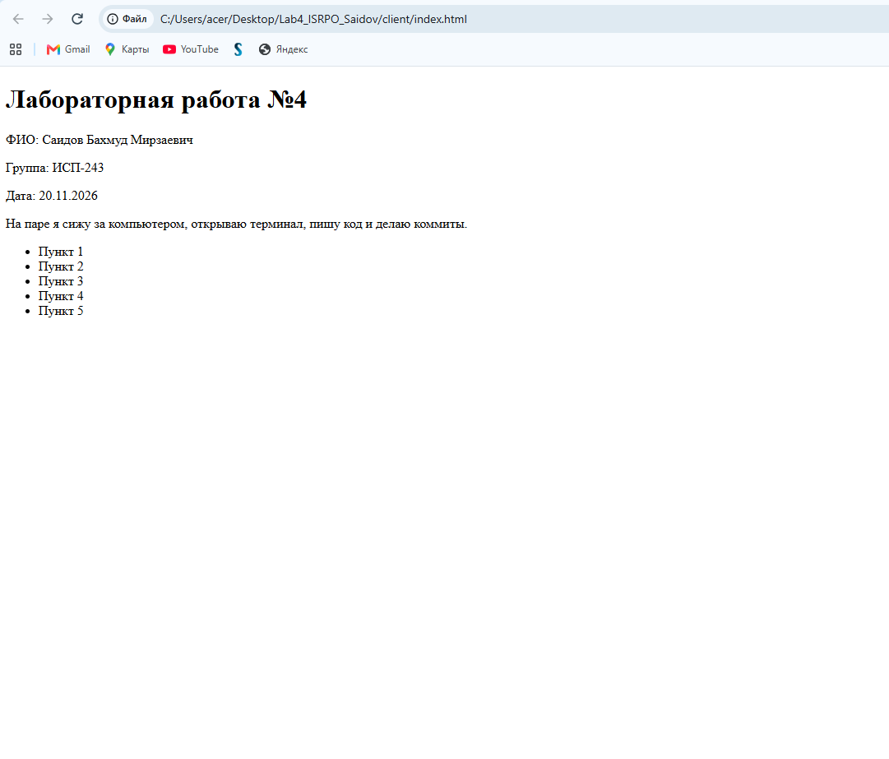
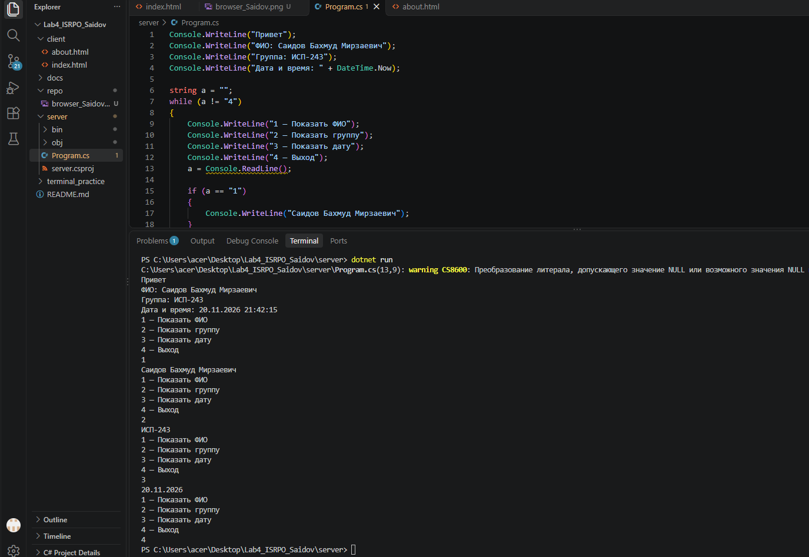
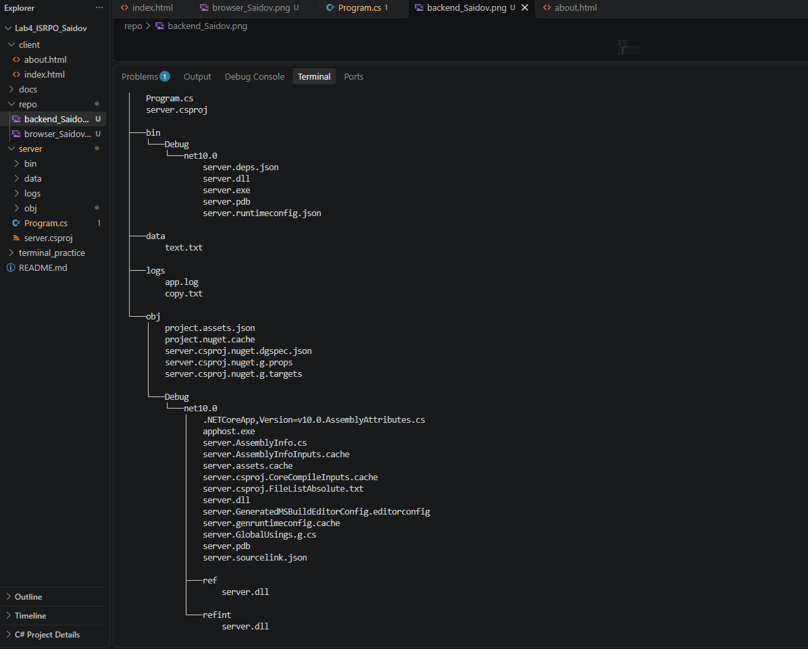
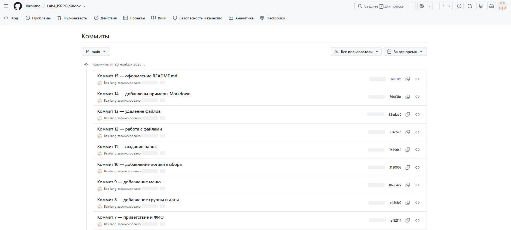

# Лабораторная работа №4

**ФИО:** Саидов Бахмуд Мирзаевич  
**Группа:** ИСП-243  
**Дата:** 20.11.2026  

## Описание проекта
Закрепление навыков работы с Git, Markdown, терминалом и проектной структурой.

## Содержание
- [Структура проекта](#структура-проекта)
- [Примеры Markdown](#примеры-markdown)
- [Пример LaTeX](#пример-latex)
- [Скриншоты](#скриншоты)
- [Заключение](#заключение)

## Структура проекта
- `client/` — frontend-часть (`index.html`, `about.html`)
- `docs/` — документация Markdown
- `repo/` — скриншоты выполнения
- `server/` — консольное приложение на C#
- `terminal_practice/` — практика работы в терминале
- `README.md` — описание проекта

## Примеры Markdown
### Подзаголовок
* Элемент списка 1
* Элемент списка 2

`dotnet run`

## Пример LaTeX
Формула в строке: $a^2 + b^2 = c^2$

Блочная формула:
$$
\sum_{i=1}^n i = \frac{n(n+1)}{2}
$$

## Ссылка на репозиторий
[Мой репозиторий на GitHub](https://github.com)

## Скриншоты

## Заключение
В ходе лабораторной работы были закреплены навыки работы с Git, терминалом, HTML, C# и Markdown.
