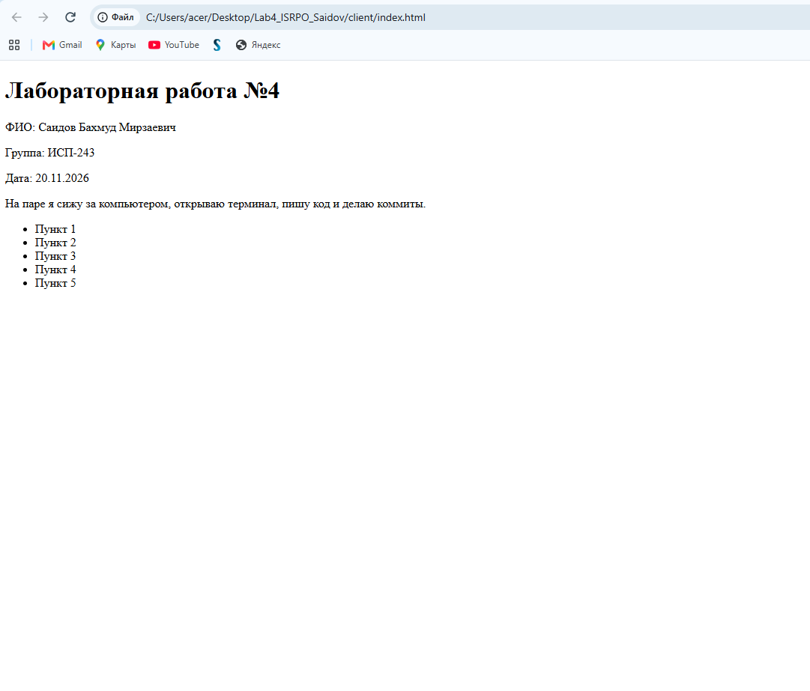

ФИО: Саидов Бахмуд Мирзаевич  
Группа: ИСП-243  
Дата: 20.11.2026  

# Заголовок 1
## Заголовок 2
### Заголовок 3
#### Заголовок 4
##### Заголовок 5
###### Заголовок 6

---

**Жирный текст**  
*Курсив*  
~~Зачёркнутый~~  
`Моноширный`

* Маркированный пункт 1
* Маркированный пункт 2
  * Вложенный пункт

1. Нумерованный пункт 1
2. Нумерованный пункт 2

> Пример цитаты

```bash
git status
```

| Столбец 1 | Столбец 2 | Столбец 3 |
| :--- | :--- | :--- |
| Текст 1 | Текст 2 | Текст 3 |



[Внешняя ссылка на GitHub](https://github.com)  
[Внутренняя ссылка на README](../README.md)

- [x] Сделано
- [ ] Не сделано

> [!NOTE]
> Пример

Inline LaTeX: $a^2 + b^2 = c^2$

Block LaTeX:
$$
\sum_{i=1}^n i = \frac{n(n+1)}{2}
$$
